Principios de diseño sobre el throughput.

---

## Síntesis Ejecutiva para el Arquitecto Senior

### 1. La anatomía del tráfico manda sobre el volumen agregado (*Throughput Fallacy*)
Mover $$100\ \text{MB/s}$$ es una métrica vacía si no se descompone en **paquetes por segundo (PPS)** y **tamaño de carga útil (payload)**:
- **Alta frecuencia / Carga diminuta ($$100\text{k req/s}, 1\ \text{kB}$$):** El recurso crítico es el plano de control del sistema operativo (interrupciones de red, *context switches*, agotamiento de sockets TCP, contención de candados en memoria). Demanda I/O no bloqueante (`epoll`), buffers en memoria y estructuras LSM.
- **Baja frecuencia / Carga masiva ($$3\text{ req/min}, 2\ \text{GB}$$):** El recurso crítico es el espacio de direcciones de memoria y la persistencia de canal. Cargar el payload en memoria desata el *OOM Killer*. Demanda *streaming* por bloques (*chunked multipart upload*), desacoplamiento de metadatos en base de datos y desvío de datos binarios directamente hacia almacenamiento de objetos (S3/GCS).

### 2. La regla del orden de magnitud ($$10\times$$ Rule)
- Los sistemas informáticos sufren **fallas cualitativas**, no degradaciones lineales. El cuello de botella físico salta de componente cada vez que la carga se multiplica por 10 (de CPU local a contención de conexiones, luego a saturación de disco y finalmente al límite de consistencia distribuida).
- **Diseñar para más de un orden de magnitud por adelantado es un antipatrón de costo y agilidad.** Construir para $$100\times$$ prematuramente introduce la penalidad de los sistemas distribuidos (redes no confiables, sincronización de relojes, consistencia eventual) sobre un modelo de negocio que probablemente mutará antes de alcanzar esa escala [27].
- El objetivo del diseño no es la inmutabilidad, sino la **modularidad evolutiva**: crear contratos e interfaces con bajo acoplamiento para sustituir piezas saturadas sin reescribir el dominio.

---

## 2. ¿Qué significa el "re-thinking continuo" de la arquitectura?

El segundo párrafo toca una regla de oro de la ingeniería de software: **los sistemas no escalan de forma lineal indefinidamente; fallan de forma cualitativa cada vez que la carga se multiplica por 10 (un orden de magnitud)** [27].

Un diseño que funciona de maravilla a una escala dada suele romperse por completo cuando la demanda crece $$10\times$$, porque el factor limitante del sistema cambia de lugar.

### La Evolución por Órdenes de Magnitud ($$10\times$$)

Veamos cómo una tienda de comercio electrónico se ve forzada a **replantear su arquitectura** en cada salto de $$10\times$$:

| Escala de Carga | Cuello de Botella Principal | Cómo luce la Arquitectura | Por qué no sirve la anterior |
| :--- | :--- | :--- | :--- |
| **$$10^1$$ (10 req/s)** *Etapa Inicial* | Velocidad de desarrollo y puesta en producción. | Monolito clásico (Django/Rails/Laravel) con una sola base de datos PostgreSQL en una misma máquina virtual. | La simplicidad es óptima. Todo corre en un solo servidor de $$20$$ USD. |
| **$$10^2$$ (100 req/s)** *Primer Crecimiento* | CPU y RAM de la base de datos compitiendo con la app. | Separar servidor de aplicaciones de la base de datos. Poner réplicas de lectura (*Read Replicas*) y un caché en memoria (**Redis**) para consultas frecuentes. | El monolito en una sola máquina agotó sus núcleos de CPU procesando plantillas web y consultas SQL a la vez. |
| **$$10^3$$ (1,000 req/s)** *Escala Media* | Conexiones concurrentes a PostgreSQL y escrituras bloqueantes. | Capa de microservicios o monolito modular, poolers de conexión (**PgBouncer**), colas asíncronas (**RabbitMQ/SQS**) para diferir tareas pesadas (correos, cobros). | La base de datos colapsa por contención de bloqueos (*row locks*) en tablas transaccionales y agotamiento de procesos. |
| **$$10^4$$ (10,000 req/s)** *Gran Escala* | Capacidad física de escritura de un solo nodo primario de base de datos. | Fragmentación de datos (**Sharding**), bases de datos NoSQL/distribuidas (CockroachDB, DynamoDB), arquitecturas orientadas a eventos (**Kafka**), balanceadores con terminación TLS y CDNs globales. | No existe una máquina lo bastante grande en el mundo para procesar tantas transacciones ACID por segundo en un único disco primario. |

---

## Diagrama de Arquitectura: Workload Shapes & Scalability Evolution

```mermaid
flowchart TD
    subgraph Part1 [Part 1: The Fallacy of Raw Throughput - 100 MB/s Comparison]
        direction LR

        subgraph HighFreqLowSize [High Concurrency / Micro-Payload: IoT / Telemetry]
            direction TB
            InputA[Traffic Pattern:<br/>100,000 req/sec * 1 kB = 100 MB/sec]
            
            subgraph ArchA [Architectural Pipeline]
                IngressA[Layer 4 Load Balancer<br/>TCP/UDP Persistent Multiplexing]
                EventLoop[Non-Blocking I/O Worker Fleet<br/>epoll / Netty / Go Routines]
                LSMStore[(LSM-Tree In-Memory Store<br/>e.g., Redis / ScyllaDB)]
            end
            
            BottleneckA[<b>Primary Hardware Bottlenecks:</b><br/>• Packets Per Second - PPS<br/>• Kernel Interrupts & Context Switches<br/>• Network Socket Depletion]

            InputA --> IngressA --> EventLoop --> LSMStore
            ArchA -.-> BottleneckA
        end

        subgraph LowFreqHighSize [Low Concurrency / Macro-Payload: Medical Imaging / Video]
            direction TB
            InputB[Traffic Pattern:<br/>3 req/min * 2 GB = 100 MB/sec]
            
            subgraph ArchB [Architectural Pipeline]
                PresignedURL[Presigned Ingress URL<br/>Direct Client-to-Storage Bypass]
                StreamWorker[Chunked Streaming Engine<br/>Constant 16 MB Memory Buffer]
                ObjStore[(Object Storage Pool<br/>e.g., S3 / MinIO Multipart)]
                MetaDB[(Metadata RDBMS<br/>Row Pointer strictly to URI)]
            end
            
            BottleneckB[<b>Primary Hardware Bottlenecks:</b><br/>• RAM Exhaustion - OOM Killer Risk<br/>• TCP Stream Timeouts & Retries<br/>• Disk Channel Bandwidth]

            InputB --> PresignedURL --> StreamWorker
            StreamWorker --> ObjStore
            StreamWorker --> MetaDB
            ArchB -.-> BottleneckB
        end
    end

    subgraph Part2 [Part 2: The 10x Evolutionary Scale Rule]
        direction TB

        Scale10[10 req/sec: Monolithic Simplicity<br/>Single VM: App Engine + Relational DB<br/>Focus: Time to Market & Fast Feature Velocity]
        
        Scale100[100 req/sec: Resource Decoupling<br/>Split App Servers from Dedicated Database Node<br/>Introduce In-Memory Cache e.g., Redis for Reads]

        Scale1000[1,000 req/sec: Connection & Lock Contention<br/>DB Connection Pooling e.g., PgBouncer<br/>Asynchronous Message Queues for Heavy Background Work]

        Scale10000[10,000+ req/sec: Physical Write Limits<br/>Horizontal Database Sharding / Distributed NoSQL<br/>Event-Driven Architecture & Global CDN Ingress]

        Scale10 ==>|10x Load Shift: CPU Contention| Scale100
        Scale100 ==>|10x Load Shift: Connection Saturation| Scale1000
        Scale1000 ==>|10x Load Shift: Single-Node Disk ACID Cap| Scale10000

        AntiPattern[<b>Architectural Rule of Thumb:</b><br/>Designing for 100x in advance generates massive complexity debt.<br/>Design for the current load and engineer boundaries to survive the next 10x.]
    end

    Part1 ~~~ Part2
```

---

## Matriz de Decisión para Revisiones de Diseño (RFC / ADR)

| Pregunta de Arquitectura | Señal de Alerta Junior | Decisión Senior |
| :--- | :--- | :--- |
| **¿Cómo escalamos este servicio de ingestión?** | "Usemos Kafka y microservicios porque mueven muchos gigabytes al día". | Descomponer el perfil de I/O: ¿cuál es el tamaño medio de mensaje ($$p_{50}$$, $$p_{99}$$)? ¿Cuál es la tasa de llegadas por segundo? |
| **¿Dónde guardamos archivos grandes subidos por usuarios?** | Convertir el binario a Base64 y guardarlo en una columna `BYTEA/BLOB` o pasarlo por la cola de mensajería. | Evitar que el payload pase por el backend: generar una URL prefirmada hacia almacenamiento de objetos y procesar metadatos de forma asíncrona mediante webhooks/eventos. |
| **¿Debemos particionar (*shardear*) la base de datos hoy?** | "Sí, porque planeamos tener 10 millones de usuarios en 3 años". | "No. Optimicemos índices, apliquemos poolers de conexión y leamos réplicas. El particionado añade complejidad que pagaremos hoy sin necesitarla hoy". |

---

### Referencias
- **[27]** Kleppmann, M. (2017). *Designing Data-Intensive Applications: The Big Ideas Behind Reliable, Scalable, and Maintainable Systems*. O'Reilly Media. ISBN: 978-1449373320.

