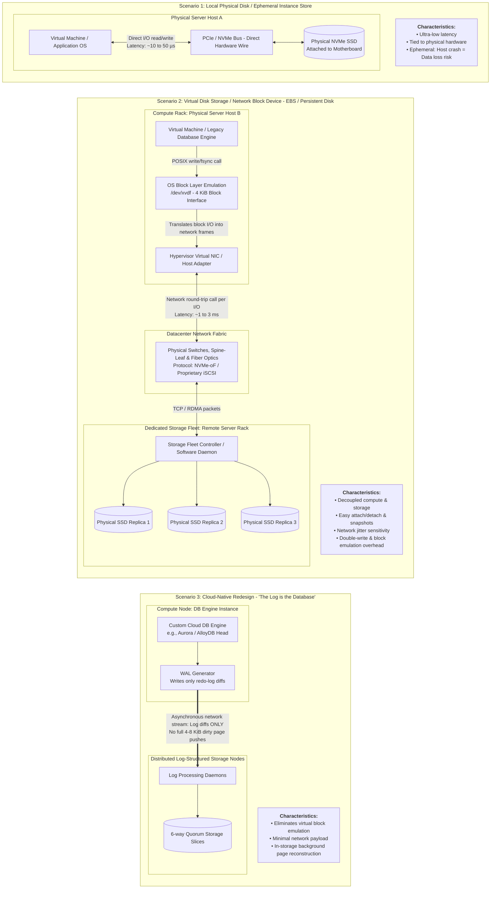

Production-grade diagram contrasting **Physical Local Disks**, **Networked Virtual Disks (Block Emulation)**, and **Cloud-Native Log-Structured Storage (e.g., Aurora / AlloyDB)**.

---

## Architectural Takeaway Matrix

| Architecture Pattern | Where the Bytes Physically Land | Communication Mechanism | Core Bottleneck / Risk | Primary Architectural Fit |
| :--- | :--- | :--- | :--- | :--- |
| **Local Physical Disk** (*Instance Store*) | Inside the same bare-metal chassis as your compute core. | Local motherboard PCIe/NVMe controller. | **Node Durability:** Host hardware failure drops the storage. | Caches, ScyllaDB/Cassandra with application-level replication, HFT scratchpads. |
| **Virtual Disk** (*EBS, Azure Managed Disk*) | In a separate storage rack across the data center. | Block emulation over high-speed Ethernet (NVMe-oF/iSCSI). | **Network Overhead:** Every file `fsync()` incurs a network round-trip. | Lift-and-shift legacy apps, general VMs, databases needing instant volume detachment. |
| **Cloud-Native Storage** (*Aurora, AlloyDB*) | Fleet of storage nodes applying redo logs in background. | Custom log-streaming RPCs bypassing block drivers. | **Cloud Vendor Lock-in:** Tied to proprietary engine primitives. | High-concurrency relational OLTP without the performance penalties of virtual block devices. |