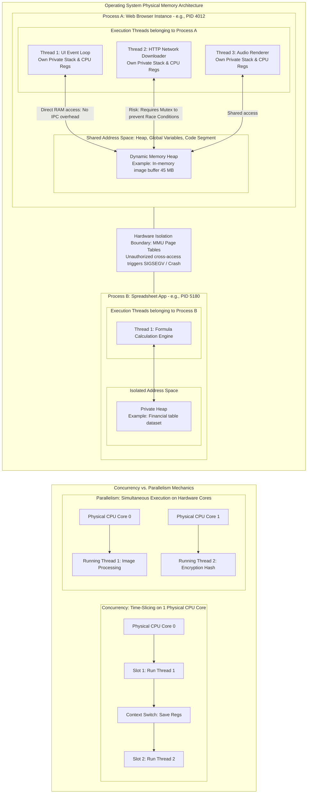
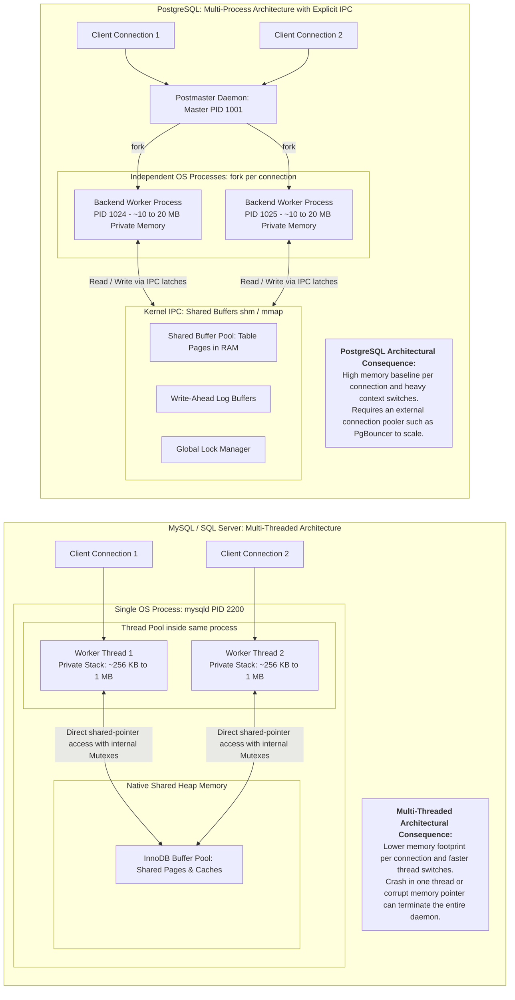

### Diagram 1: Operating System Fundamentals (Processes vs. Threads & Execution Models)



---

### Diagram 2: Database Concurrency Architectures (PostgreSQL Multi-Process vs. MySQL Multi-Threaded)



---

### Key Architectural Takeaways

1. **Process vs. Thread (Isolation vs. Efficiency):**
   - **Process:** Isolated sandbox. If it crashes, it does not corrupt other processes. Communication requires explicit operating system mechanisms (IPC, sockets, shared memory segments). 
   - **Thread:** Lightweight execution flow inside a process. Shares the entire memory heap. Fast communication via pointers, but requires strict synchronization (mutexes, locks) to prevent race conditions.
2. **Concurrency vs. Parallelism:**
   - **Concurrency** is about *structuring* a system to handle multiple tasks by interleaving execution (can happen on a single CPU core via time-slicing). Es la capacidad de un sistema para gestionar múltiples tareas intercalando su progreso. Puede ocurrir en un procesador de un solo núcleo mediante cambios de contexto (context switching) ultrarrápidos organizados por el planificador del sistema operativo [1].
   - **Parallelism** is about *hardware execution* doing multiple calculations simultaneously across multiple physical CPU cores. Requiere múltiples núcleos físicos de CPU reales corriendo al mismo tiempo. El hilo 1 corre físicamente en el silicio del Núcleo A, mientras el hilo 2 corre en el silicio del Núcleo B [2].
3. **Database Operational Design:**
   - **PostgreSQL** protects memory safety by isolating connections into separate OS processes, but this demands connection pooling (`PgBouncer`) because thousands of OS processes cause RAM exhaustion and CPU scheduler degradation.
   - **MySQL/InnoDB and SQL Server** handle connections as internal threads inside a single process, offering lighter resource allocation per connection at the cost of shared-memory blast radius.

[1] Silberschatz, A., Galvin, P. B., & Gagne, G. (2018). Operating System Concepts (10th ed.). Wiley. ISBN: 978-1119320913. (Capítulos sobre Procesos, Hilos y Memoria Virtual).
[2] Hennessy, J. L., & Patterson, D. A. (2017). Computer Architecture: A Quantitative Approach (6th ed.). Morgan Kaufmann. ISBN: 978-0128119051. (Capítulo sobre Multiprocesadores y Coherencia de Caché).


-----


Para consolidar tu perfil de arquitecto senior, este es el cimiento más importante de las ciencias de la computación: **cómo el sistema operativo organiza el cómputo y la memoria física.** 

Todo lo que diseñamos arriba (microservicios, Kubernetes, bases de datos o motores analíticos) son abstracciones construidas sobre dos primitivas del kernel: **procesos** e **hilos (*threads*)** [1], [2].

A continuación desglosamos la anatomía de la memoria compartida, la diferencia matemática entre concurrencia y paralelismo, el motivo del costo no lineal que menciona tu texto, y el caso concreto de PostgreSQL frente a otros motores.

---

## 🏛️ Procesos vs. Hilos: La frontera de la memoria física

La diferencia fundamental entre un proceso y un hilo no es el código que ejecutan, sino **el aislamiento de su espacio de direcciones de memoria (RAM)** [1].

```
┌────────────────────────────────────────────────────────────────────────┐
│ MEMORIA FÍSICA (RAM)                                                   │
│                                                                        │
│  PROCESO A (Espacio de Direcciones Ailado - Page Tables)               │
│  ┌──────────────────────────────────────────────────────────────────┐  │
│  │ Código (.text) | Datos Globales (.data) | Memoria Dinámica (Heap)│  │
│  │  ▲                                                               │  │
│  │  │ (Acceso directo a las mismas variables compartidas)           │  │
│  │  ├───────────────────────────────┬────────────────────────────┐  │  │
│  │  │ Hilo 1 (Thread 1)             │ Hilo 2 (Thread 2)          │  │  │
│  │  │ Stack Propio | Registros CPU  │ Stack Propio | Regs CPU    │  │  │
│  │  └───────────────────────────────┴────────────────────────────┘  │  │
│  └──────────────────────────────────────────────────────────────────┘  │
│                             ▲                                          │
│                    BARRERA DE AISLAMIENTO                              │
│                    (Fallo de segmentación / SIGSEGV si se cruza)       │
│                             ▼                                          │
│  PROCESO B (Espacio de Direcciones Totalmente Independiente)           │
│  ┌──────────────────────────────────────────────────────────────────┐  │
│  │ Código propio | Heap propio | Hilos propios                      │  │
│  └──────────────────────────────────────────────────────────────────┘  │
└────────────────────────────────────────────────────────────────────────┘
```

### 1. El Proceso (*Process*)
Un proceso es un **programa en ejecución** al que el sistema operativo le asigna una burbuja protectora y recursos dedicados:
- **Espacio de memoria virtual propio:** Si el Proceso A escribe en la dirección de memoria `0x0040A1`, esa dirección pertenece únicamente a él. El Proceso B no puede leerla ni escribirla por defecto. Si el Proceso B intenta invadir la memoria del Proceso A, la Unidad de Manejo de Memoria (MMU) del CPU lanza un error fatal de protección (*Segmentation Fault* / `SIGSEGV`) [1].
- **Costo de creación y conmutación alto:** Crear un proceso (`fork()` en Linux) requiere clonar o crear descriptores de archivos, tablas de páginas virtuales (*page tables*) y estructuras de permisos en el kernel.

### 2. El Hilo (*Thread*)
Un hilo es la **unidad básica de ejecución que planifica la CPU** dentro de un proceso. Un proceso puede tener decenas o cientos de hilos:
- **"Belonging to the same process" (Pertenecen al mismo proceso):** Todos los hilos generados por el Proceso A viven dentro de su misma burbuja.
- **"Can access the same RAM" (Memoria compartida):** Los hilos comparten el mismo código, los mismos archivos abiertos y, críticamente, **el mismo *Heap* (memoria dinámica)** [1], [2].
- **Lo que es privado de cada hilo:** Cada hilo tiene únicamente su propia pila de llamadas (*Call Stack*) para variables locales temporales y su propio juego de registros en la CPU (puntero de instrucción, estado de registros).
- **Consecuencia de arquitectura:** La comunicación entre hilos es instantánea (un hilo escribe un valor en un puntero de RAM y el otro hilo lo lee inmediatamente, sin pasar por la red ni por sockets del kernel). Sin embargo, esto introduce el infierno de la concurrencia: **condiciones de carrera (*race conditions*)**, bloqueos mutuos (*deadlocks*) y la necesidad de usar candados (*mutexes*, semáforos) para evitar corromper los datos [2].

---

## ⚡ Concurrencia vs. Paralelismo

A menudo se confunden, pero describen problemas diferentes:

```
CONCURRENCIA (Estructura: lidiar con muchas cosas a la vez)
1 Núcleo de CPU: Alterna rápidamente en el tiempo (Time Slicing / Context Switch)
Tiempo: ──[Hilo 1]──►──[Hilo 2]──►──[Hilo 1]──►──[Hilo 2]──►

PARALELISMO (Ejecución: hacer muchas cosas exactamente al mismo milisegundo)
Núcleo 1: ──[Hilo 1: Calculando matriz A]──────────────────►
Núcleo 2: ──[Hilo 2: Calculando matriz B]──────────────────►
```

- **Concurrencia:** Es la capacidad de un sistema para gestionar múltiples tareas intercalando su progreso. Puede ocurrir en un procesador de **un solo núcleo** mediante cambios de contexto (*context switching*) ultrarrápidos organizados por el planificador del sistema operativo [1].
- **Paralelismo:** Requiere **múltiples núcleos físicos de CPU reales corriendo al mismo tiempo**. El hilo 1 corre físicamente en el silicio del Núcleo A, mientras el hilo 2 corre en el silicio del Núcleo B [2].

---

## 📈 ¿Por qué el texto dice que el costo crece más rápido que linealmente?

El fragmento resalta un dilema clásico de escalabilidad vertical (*Scale-Up* / SMP / NUMA):

> *"a high-end machine with twice the hardware resources... costs significantly more than twice as much... unlikely to actually be able to handle twice the load."*

¿Por qué ocurre esto físicamente en la arquitectura de memoria compartida?

1. **Contención de Caché y Coherencia de Bus:**
   Cuando tienes 64 o 128 núcleos en un solo servidor físico intentando escribir en la misma memoria RAM compartida, los núcleos pasan más tiempo coordinando qué versión de los datos es la válida en sus memorias caché L1/L2/L3 (protocolos de coherencia como MESI) que calculando operaciones útiles [2].
2. **Arquitectura NUMA (*Non-Uniform Memory Access*):**
   En servidores grandes con varios zócalos de procesador (múltiples sockets físicos de CPU), la memoria RAM se divide físicamente. Si el Núcleo del CPU 1 necesita leer una variable que está físicamente soldada en el banco de memoria del CPU 2, debe cruzar un bus inter-socket (como Intel UPI o AMD Infinity Fabric), lo que dispara la latencia.
3. **Costo de Hardware Especializado:**
   Diseñar placas base y chipsets con tolerancias térmicas, buses masivos y fuentes de alimentación para sostener 128 núcleos con 2 TB de RAM compartida cuesta exponencialmente más que comprar 4 servidores pequeños estándar de 32 núcleos conectados por una red Ethernet común [2], [27].

---

## 🐘 ¿Es el mismo concepto en las bases de datos? El caso especial de PostgreSQL

**Aquí hay una trampa técnica que todo arquitecto debe conocer:** No todas las bases de datos manejan las conexiones con hilos.

```
MODELO POSTGRESQL: Multi-Proceso (Process-per-connection)
Cliente 1 ──► Proceso Backend 1 (PID 1024) ──┐
Cliente 2 ──► Proceso Backend 2 (PID 1025) ──┼──► Memoria Compartida Especial
Cliente 3 ──► Proceso Backend 3 (PID 1026) ──┘    (Shared Buffers / IPC / shm)

MODELO MYSQL / SQL SERVER: Multi-Hilo (Thread-per-connection)
Cliente 1 ──► Hilo 1 (Thread 1) ──┐
Cliente 2 ──► Hilo 2 (Thread 2) ──┼──► Un solo Proceso mysqld / sqlservr
Cliente 3 ──► Hilo 3 (Thread 3) ──┘    (Todo el Heap es compartido naturalmente)
```

### 1. PostgreSQL es Multi-Proceso, NO Multi-Hilo por defecto
Históricamente (diseñado en los años 80 en Unix), **PostgreSQL asigna un proceso completo del sistema operativo a cada conexión de cliente** [3].
- Cuando tu aplicación abre una conexión a PostgreSQL, el proceso maestro (*postmaster*) ejecuta una llamada `fork()` en Linux y levanta un proceso hijo independiente (ej. con su propio PID en `top` o `htop`).
- **¿Cómo comparten datos si los procesos son aislados?** PostgreSQL le pide al kernel un segmento de memoria compartida explícito mediante primitivas de IPC (*Inter-Process Communication* o `mmap/shm`), conocido como **Shared Buffers**. Ahí residen las páginas de datos y el WAL [3].
- **Impacto arquitectónico:** Los procesos consumen más memoria RAM base que los hilos y su conmutación de contexto es más pesada. Por eso PostgreSQL se satura rápidamente si le envías 5,000 conexiones directas sin un pooler de conexiones (como **PgBouncer** u **Odyssey**), el cual mantiene un número acotado de procesos fijos reutilizables [3].

### 2. Otras bases de datos usan Multi-Hilo (MySQL, Oracle, SQL Server)
Motores como **MySQL (InnoDB)** o **Microsoft SQL Server** corren como **un único gran proceso del sistema operativo**. 
- Cada nueva conexión de cliente crea simplemente un **hilo (*thread*)** dentro de ese proceso.
- Los hilos consumen menos memoria inicial y alternan más rápido, pero si un hilo tiene un fallo catastrófico de memoria que no es capturado, en teoría puede comprometer la estabilidad de todo el proceso del motor de base de datos.

*(Nota técnica: Las versiones modernas de PostgreSQL introdujeron "Parallel Query", donde un proceso backend puede delegar trabajo de escaneo a varios procesos trabajadores paralelos temporales, pero la arquitectura base de conexión sigue siendo multi-proceso).*

---

## 💡 Síntesis para el Arquitecto

1. **Mismo Proceso / Mismos Hilos = Misma RAM:** Permite comunicación ultrarrápida en memoria compartida, pero requiere sincronización estricta para evitar condiciones de carrera [1], [2].
2. **Procesos Aislados = Memoria Separada:** Mayor seguridad y tolerancia a fallos (si uno muere, no tira a los demás), pero la comunicación requiere IPC, sockets o memoria compartida explícita del kernel [1].
3. **Escalar Verticalmente tiene rendimientos decrecientes:** Duplicar el tamaño de una máquina monolítica de memoria compartida cuesta más del doble y topa contra cuellos de botella de sincronización de caché y buses de memoria (NUMA) [2].
4. **En bases de datos:** Conocer si el motor opera mediante procesos (PostgreSQL) o hilos (MySQL) define tu estrategia de dimensionamiento de pools de conexión, memoria y concurrencia máxima [3].

---

### Referencias
- **[1]** Silberschatz, A., Galvin, P. B., & Gagne, G. (2018). *Operating System Concepts* (10th ed.). Wiley. ISBN: 978-1119320913. (Capítulos sobre Procesos, Hilos y Memoria Virtual).
- **[2]** Hennessy, J. L., & Patterson, D. A. (2017). *Computer Architecture: A Quantitative Approach* (6th ed.). Morgan Kaufmann. ISBN: 978-0128119051. (Capítulo sobre Multiprocesadores y Coherencia de Caché).
- **[3]** Stonebraker, M., & Kemnitz, G. (1991). *The Postgres Next-Generation Database Management System*. Communications of the ACM, 34(10), 78–92. doi:10.1145/125223.125262.
- **[27]** Kleppmann, M. (2017). *Designing Data-Intensive Applications: The Big Ideas Behind Reliable, Scalable, and Maintainable Systems*. O'Reilly Media. ISBN: 978-1449373320.