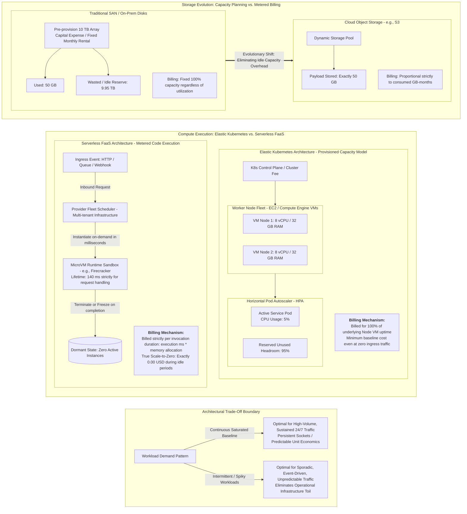

Diagram illustrating the transition from capacity-planned provisioning to metered execution, contrasting Elastic Kubernetes with Serverless (FaaS) mechanics.




-----------------------

Para despejar de raíz esta confusión y dominar este concepto con el rigor de un arquitecto senior, debemos desarmar una ilusión común de la industria: **la diferencia entre pagar por *recursos aprovisionados (capacidad reservada)* frente a pagar por *trabajo efectivamente realizado (ejecución medida)*.**

Alojar un microservicio en un clúster de Kubernetes elástico **no es lo mismo** que operar bajo un modelo Serverless puro, aunque ambos escalen automáticamente hacia arriba y hacia abajo. 

Veamos primero la analogía entre almacenamiento y cómputo que menciona el texto, y luego la diferencia técnica y económica entre Kubernetes elástico y Serverless.

---

## La Analogía: De Planificar Capacidad a Facturación por Uso

El texto traza un paralelismo histórico exacto entre lo que ocurrió con el **almacenamiento** y lo que ahora ocurre con el **cómputo**:

```
ERA TRADICIONAL (On-Prem / VMs fijas)       ERA DE CONSUMO NATIVO (Pay-per-use)
┌──────────────────────────────────────┐     ┌──────────────────────────────────────┐
│  CAPACITY PLANNING (Anticipado)      │     │  METERED BILLING (Por Consumo)       │
│                                      │     │                                      │
│  Almacenamiento:                     │     │  Almacenamiento:                     │
│  "Compro un SAN de 10 Terabytes hoy  │ ──► │  "Uso AWS S3: si hoy guardo 1 MB,    │
│   aunque solo use 50 GB, por si     │     │   pago por 1 MB. Si no guardo nada,  │
│   crezco en 3 años". (Costo Fijo)    │     │   pago $0.00". (Costo Variable)      │
│                                      │     │                                      │
│  Cómputo:                            │     │  Cómputo (Serverless):               │
│  "Dejo 3 servidores prendidos 24/7   │ ──► │  "Uso AWS Lambda / Cloud Functions:  │
│   esperando clientes, aunque a las   │     │   si de 2 a 5 AM nadie llama a la    │
│   3 AM no entre nadie".              │     │   API, pago $0.00".                  │
└──────────────────────────────────────┘     └──────────────────────────────────────┘
```

### Ejemplo Breve en la Vida Real
Imagina un servicio que procesa facturas electrónicas de un restaurante:
- **Modelo de Capacidad (VMs / Servidores clásicos):** Alquilas un camión de carga todo el mes por $$1,000$$ USD. El camión está estacionado frente a tu puerta las 24 horas del día. Si en todo el mes solo transportas un sobre pequeño, pagas los mismos $$1,000$$ USD porque el camión estaba reservado exclusivamente para ti.
- **Modelo Medido (Serverless / FaaS):** Contratas un servicio de mensajería por viaje (como Uber). Solo pagas los $$3$$ dólares por los 12 minutos exactos que tardó la moto en llevar el sobre. Si no envías paquetes durante todo el fin de semana, la factura es literalmente **$$0.00$$**.

---

## Kubernetes Elástico (HPA/Autoscaling) vs. Serverless Puro (FaaS)

Aquí está el núcleo de tu duda: *"¿Por qué Kubernetes elástico no es lo mismo si también escala según la demanda?"*

La distinción técnica radica en tres factores: **el suelo de costo (*Scale to Zero*), la granularidad de la métrica de cobro y la propiedad del plano de control.**

| Dimensión de Arquitectura | Kubernetes Elástico (EKS / GKE con HPA + Cluster Autoscaler) | Serverless / FaaS (AWS Lambda, Cloud Run, Google Cloud Functions) |
| :--- | :--- | :--- |
| **¿Por qué pagas exactamente?** | Por la **capacidad del hardware subyacente** (RAM y vCPU aprovisionada por hora en los *Worker Nodes*), **estén o no ocupados al 100%**. | Por los **milisegundos exactos** de CPU/Memoria que tu código tardó en procesar el evento (ej. cobro por incrementos de $$1\ \text{ms}$$). |
| **Escala a Cero (*Scale-to-Zero*)** | **Casi nunca es costo cero real.** Aunque tus Pods bajen a 0 réplicas, sigues pagando por los nodos mínimos de la máquina virtual que sostienen el clúster (o el costo base del plano de control de EKS/GKE). | **Costo cero absoluto ($$0.00$$).** Si nadie hace peticiones durante 10 horas, no hay servidores encendidos ni infraestructura asignada a tu nombre. |
| **Tiempo de reacción al escalar** | **Segundos a Minutos:** Si el clúster se queda sin espacio y necesita un nuevo Worker Node, debe arrancar una VM física/virtual nueva, registrarla en el plano de control y descargar la imagen Docker ($$\approx 1\text{--}3\text{ minutos}$$). | **Milisegundos:** El proveedor inyecta tu código en micro-máquinas virtuales ya precalentadas (*Firecracker / gVisor*) en cuestión de $$\approx 50\text{--}200\ \text{ms}$$. |
| **Mantenimiento Operativo (*Toil*)** | **Alto:** Debes parchear versiones de Kubernetes, actualizar AMI de los nodos, configurar Ingress controllers y afinar el *Horizontal Pod Autoscaler* (HPA). | **Cero:** El proveedor administra el sistema operativo, parches de seguridad del kernel, balanceadores de carga y aislamiento físico. |
| **Límite de ejecución** | **Sin límite:** Un Pod puede correr un proceso continuo durante 1 año si así lo deseas. | **Acotado:** La función tiene un tiempo límite estricto de vida por invocación (ej. máximo 15 minutos en AWS Lambda). |

---

## La Anatomía del Cobro: ¿Por qué NO pagas lo mismo?

Comparemos qué pasa a las 3:00 AM cuando tu aplicación tiene **0 visitas**:

### 1. El escenario Kubernetes Elástico
1. El *Horizontal Pod Autoscaler* (HPA) detecta cero tráfico y reduce tu despliegue a su réplica mínima (por ejemplo, 1 Pod por redundancia o incluso 0 Pods si usas KEDA).
2. Sin embargo, para que ese Pod pueda revivir, necesitas al menos un nodo trabajador (una instancia de máquina virtual, ej. `m5.large`) corriendo, consumiendo energía y facturando por segundo en la nube.
3. Además, pagas la tarifa de gestión del clúster ($$\approx \$73$$ USD/mes por clúster en AWS EKS).
4. **Resultado a fin de mes si el tráfico fue nulo:** Pagas la VM base encendida 24/7 + el clúster.

### 2. El escenario Serverless (FaaS)
1. Llega una petición HTTP.
2. La plataforma del proveedor (*Fleet Manager*) arranca un micro-contenedor aislado en un nodo compartido de su granja de servidores, ejecuta tu función durante **140 milisegundos**, devuelve la respuesta HTTP y destruye o congela el contenedor.
3. Tu factura registra: $$1\ \text{invocación} \times 140\ \text{ms} \times 128\ \text{MB de RAM} = \$0.00000029$$ USD.
4. **Resultado a fin de mes si el tráfico fue nulo:** Pagas exactamente **$$0.00$$ USD**.

---

## Criterio de Decisión para un Arquitecto Senior

Un arquitecto senior no dice *"Serverless siempre es mejor porque es más nuevo"* ni *"Kubernetes es mejor porque tengo control"*. Aplica la curva de costo y predictibilidad:

```
Costo Total
   ▲
   │                 / (Serverless se vuelve más caro con tráfico masivo 24/7)
   │                /
   │  Serverless   /
   │  ───────────►/
   │             /
   │            / ◄── Punto de Inflexión (Crossover Point)
   │           /
   │          /────────────────────── (Kubernetes / VMs tienen costo fijo plano)
   │         /  Kubernetes Elástico
   │        /
   │       /
   └──────┴────────────────────────────────► Volumen de Tráfico Constante
       Bajo / Esporádico              Alto / Predecible 24/7
```

1. **Elige Serverless (FaaS / Managed Serverless Containers como Cloud Run):**
   - Para cargas de trabajo con tráfico esporádico, impredecible o con picos brutales (ej. webhooks de cobro, procesamiento de imágenes cuando un usuario sube un archivo, tareas cron nocturnas, integraciones para agentes IA).
   - Para startups o proyectos nuevos donde el volumen inicial es bajo y no quieres quemar presupuesto manteniendo servidores ociosos.
2. **Elige Contenedores Elásticos sobre Kubernetes:**
   - Para servicios con una línea base de tráfico masivo y constante 24/7 (ej. un backend de streaming o un sistema bancario central que procesa miles de transacciones por segundo sin descanso). En este punto de saturación, el costo por milisegundo de Serverless se vuelve considerablemente más caro que pagar por procesadores dedicados y optimizados al 80% de uso continuo.
   - Cuando necesitas sockets persistentes (WebSockets de larga duración, gRPC bidireccional continuo) o tiempos de respuesta sin el retraso de arranque en frío (*cold start*).