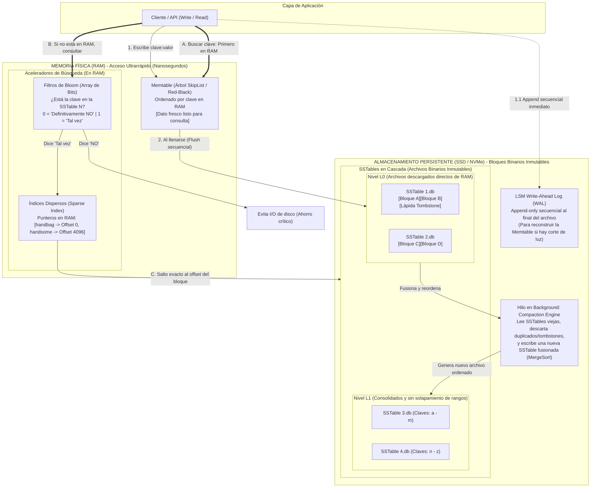
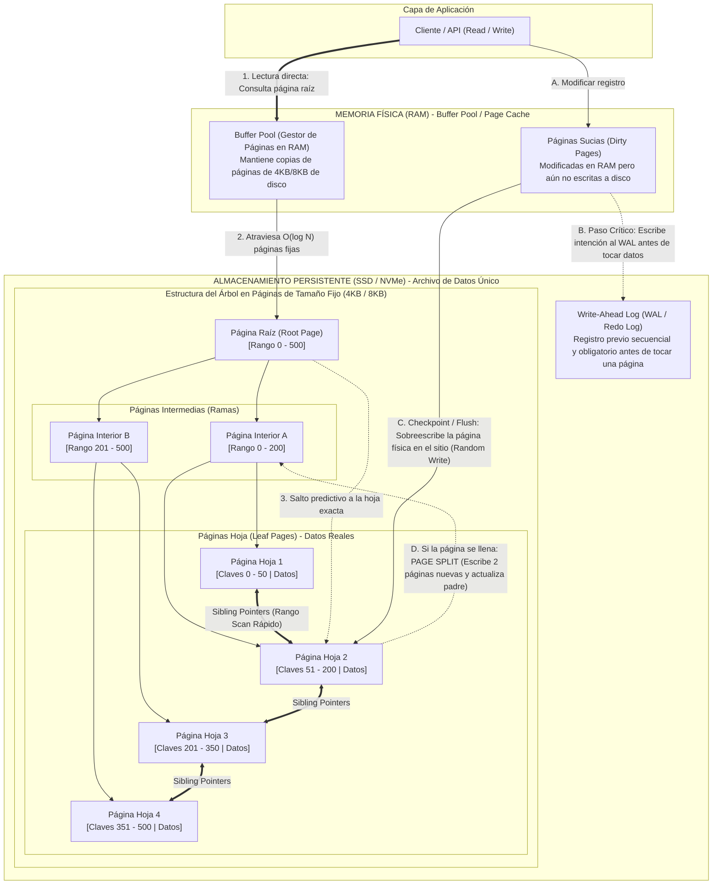

En los sistemas **OLTP** (*Online Transaction Processing* —sistemas transaccionales de bancos, carritos de compra, apps móviles con millones de lecturas/escrituras pequeñas), **la arquitectura del disco determina qué tan rápido respondes y cuánto dinero gastas en servidores**. Si entiendes este texto empiezas a predecir qué motor sobrevivirá a tu carga de trabajo y cuál colapsará.

## Desglose de Términos: ¿Qué es cada pieza?

Hay dos familias de diseño para bases de datos transaccionales: la familia **LSM-Tree** (escritura secuencial) y la familia **B-Tree** (escritura en sitio), además de la alternativa **In-Memory**.

### 1. La Familia LSM-Tree (Log-Structured Merge-Tree) y componentes
Pensada para cuando tienes **muchísimas escrituras** y no quieres ralentizar el disco buscando dónde escribir.



* **Append-only log (Registro de solo adición):** El método más rápido para escribir en disco es ir agregando datos al final de un archivo sin modificar nada del pasado.
* **Memtable (In-memory tree):** Cuando llega una escritura, en vez de ir directo a desordenar el disco, se guarda en RAM en un árbol ordenado (como un *Red-Black Tree* o *Skip List*). Así las escrituras son instantáneas y los datos están ordenados en memoria.
* **SSTable (Sorted Strings Table):** Cuando la *Memtable* se llena (unos pocos megabytes), se descarga a disco de una sola pasada en forma de un archivo llamado SSTable. Su regla de oro: **está ordenado por clave y es inmutable** (nunca se modifica, solo se lee o se borra).
* **Sparse Index (Índice disperso):** Dado que la SSTable ya está ordenada en disco, no necesitas indexar cada clave; solo guardas un puntero cada pocos kilobytes (ej. "de la clave A a la D ve al bloque 1; de la E a la H al bloque 2"). Esto ahorra memoria RAM gigantesca.
* **Compaction & Merging (Compactación):** Como no puedes sobreescribir archivos viejos, en segundo plano el motor toma varias SSTables, las mezcla en orden (como el algoritmo *MergeSort*) y elimina las versiones viejas de claves repetidas.
* **Tombstone (Lápida):** En un archivo inmutable no puedes borrar un registro anterior. Para "eliminar", escribes una marca especial (*tombstone*). Durante la compactación, cuando el proceso ve la lápida, descarta definitivamente el dato viejo.
* **Bloom Filter (Filtro de Bloom):** Una estructura matemática ultra ligera en RAM que responde: *"¿Esta clave está en esta SSTable?"*. Te puede decir con 100% de certeza *"No, aquí no está"* (ahorrándote leer el disco) o *"Quizás sí"* (y solo entonces vas a buscar al disco).

---

### 2. La Familia B-Tree y componentes
El estándar histórico de la industria (desde 1970) y el pilar de las bases de datos relacionales tradicionales.



* **Pages (Páginas / Bloques fijos):** En lugar de archivos de tamaño variable, el disco se divide en bloques fijos (típicamente 4 KiB, 8 KiB en Postgres, 16 KiB en MySQL).
* **In-place update (Actualización en el lugar):** Si actualizas el saldo de un usuario, el motor busca la página exacta donde vive ese dato y **sobreescribe** esos bytes específicos en el disco.
* **Page Split (División de página):** Si insertas una clave nueva y la página de 4 KiB está llena, se divide en dos de 2 KiB y se actualiza la página padre que apunta a ellas.
* **WAL (Write-Ahead Log):** Sobreescribir páginas directamente es peligroso: si se corta la luz en medio de una división de página, el archivo se corrompe (*torn page*). El WAL es un archivo donde se anota secuencialmente lo que se va a hacer **antes** de tocar el árbol. Si el sistema se apaga abruptamente, al reiniciar lee el WAL y repara las páginas dañadas.

---

### 3. Conceptos de Rendimiento y Hardware
* **Random vs. Sequential Writes:** Escribir secuencialmente (LSM) es mucho más veloz y gasta menos el disco que saltar a escribir bytes en posiciones aleatorias dispersas (B-Trees), incluso en discos SSD/NVMe modernos debido a cómo funciona la recolección de basura del chip de memoria.
* **Write Amplification (Amplificación de escritura):** Por cada byte que tu aplicación guarda, ¿cuántos bytes reales termina escribiendo el motor en disco por culpa del WAL, las compactaciones o la sobreescritura de páginas enteras? Menor amplificación significa mayor vida útil del SSD y mejor ancho de banda.
* **In-Memory Databases (Bases de datos en memoria):** Como Redis. Su velocidad no se debe mágicamente a no tocar el disco (los sistemas operativos ya cachean páginas en RAM), sino a que se ahorran convertir estructuras de datos ricas (listas, conjuntos) al rígido formato binario de bloques de disco.

---

## ¿Cómo se complementan para consolidar una base de datos OLTP?

Una base de datos OLTP necesita garantizar dos cosas esenciales y opuestas: **Escribir rápido y con durabilidad** (que no se pierda la transacción si se va la luz) y **Leer rápido** (encontrar el perfil o el saldo del usuario en milisegundos).

Observa cómo se orquestan internamente los componentes para resolver esto:

```
[ Solicitud de Escritura (INSERT / UPDATE) ]
                     │
         ┌───────────┴───────────┐
         ▼                       ▼
  [ 1. Escribir al WAL ]   [ 2. Memtable (RAM) ]
  (Seguridad si hay crash) (Rápido y ordenado)
                                 │ (Cuando se llena)
                                 ▼
                     [ 3. Escribir SSTable en Disco ]
                     (Inmutable, ordenada, comprimida)
                                 │
                 ┌───────────────┴───────────────┐
                 ▼                               ▼
       [ 4. Bloom Filters ]           [ 5. Compaction ]
   (Acelera lecturas futuras)     (Limpia duplicados y tumbas)
```

1. **La escritura jamás espera a reorganizar el disco:** Entra a la memoria (*Memtable*) y a un log secuencial (*WAL*). Respuesta al cliente en submilisegundos.
2. **La persistencia se desacopla:** Las *SSTables* se escriben en bloques grandes y limpios sin bloquear al usuario.
3. **La lectura esquiva el desorden:** Gracias al ordenamiento de las *SSTables*, a los *Sparse Indexes* y a los *Bloom Filters*, el motor sabe en qué microsegundo y en qué bloque exacto está la clave sin escanear gigabytes.

---

## B-Trees vs. LSM-Trees: Tabla Comparativa

La siguiente tabla resume los compromisos de ingeniería (*trade-offs*) entre ambas arquitecturas:

| Métrica / Característica | **B-Trees** (Postgres, MySQL, SQLite) | **LSM-Trees** (Cassandra, RocksDB, ScyllaDB) |
| :--- | :--- | :--- |
| **Punto fuerte** | **Lecturas rápidas y predecibles**; excelente para consultas por rango. | **Escrituras masivas**; ingestión continua de datos a alta velocidad. |
| **Estrategia en disco** | Modifica páginas fijas en el sitio (*In-place overwrite*). | Archivos inmutables secuenciales (*Append-only segments*). |
| **Mecanismo de seguridad** | Write-Ahead Log (WAL) para evitar páginas corruptas. | Log de recuperación en disco + inmutabilidad de SSTables. |
| **Espacio y Fragmentación** | Tiende a fragmentarse con muchos *DELETEs* (requiere `VACUUM`). | Muy compacta y comprimible; elimina basura durante la compactación. |
| **Costo en lecturas** | O(log N) saltando pocas páginas fijas. | Puede requerir consultar varias SSTables (mitigado por Bloom Filters). |

---

## Conclusión y Aplicación Práctica

Estos criterios me permitiran evaluar los siguientes casos:

- Si un día diseñas una pasarela de pagos con lecturas frecuentes sobre clientes y transacciones con rangos específicos, sabrás por qué un motor basado en **B-Trees (PostgreSQL/MySQL)** es la opción natural.
- Si diseñas una plataforma de telemetría IoT o un chat que recibe 500,000 mensajes por segundo, sabrás por qué necesitas un motor basado en **LSM-Trees (Cassandra/RocksDB)** para no saturar los discos con escrituras aleatorias.
- Si necesitas latencias sub-milisegundo y estructuras de datos complejas, sabrás que un motor **In-Memory (Redis)** te da esa ventaja al prescindir de la serialización en páginas de disco.