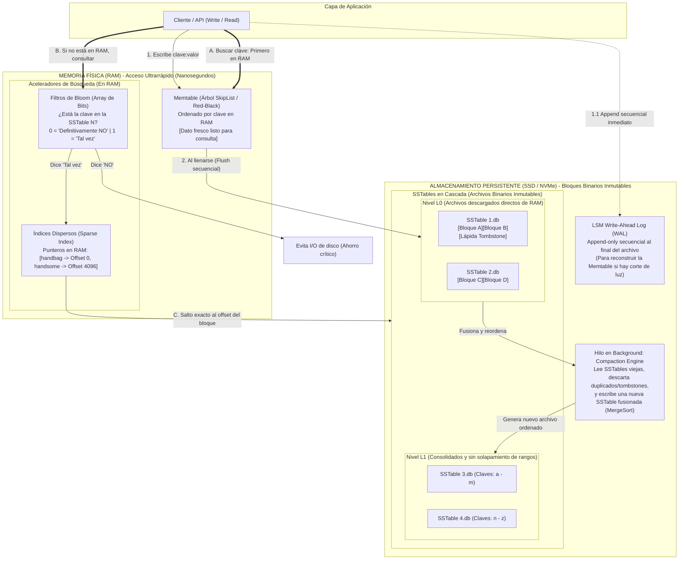
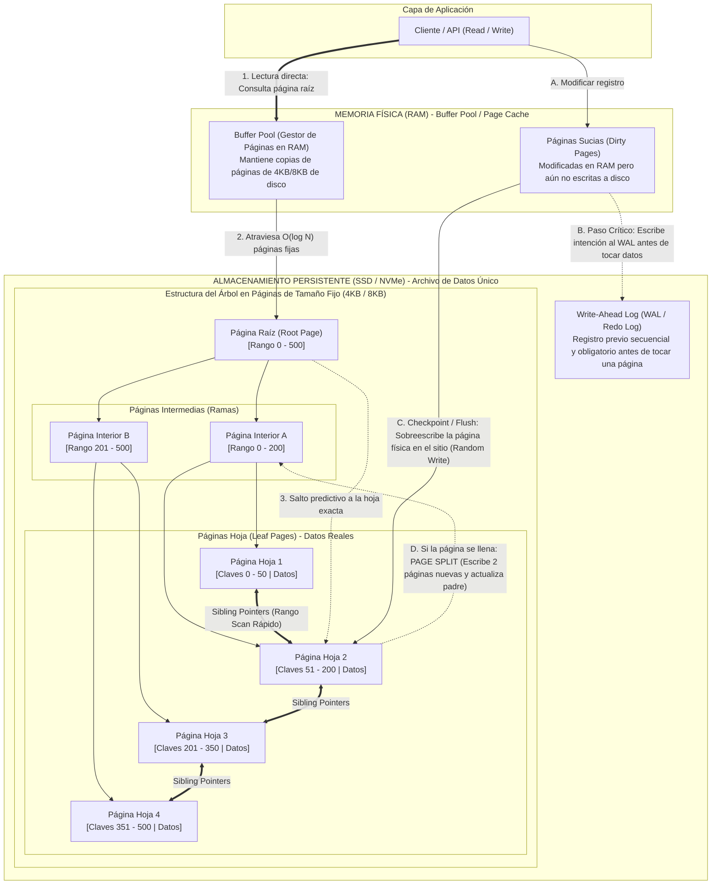

## Fundamentos de Hardware: RAM, Discos y Archivos

### 1. ¿Qué es guardar en RAM vs. guardar en Disco?
* **RAM (Memoria Volátil):** Son condensadores y transistores eléctricos microscópicos. Acceder a cualquier dirección de memoria tarda entre **10 y 100 nanosegundos**. Puedes modificar un solo bit o saltar de la posición `0x0001` a la `0xFFFF` instantáneamente (acceso aleatorio puro). Sin embargo, **si se corta la luz, los condensadores se descargan y todo se borra**.
* **Disco / SSD (Almacenamiento Persistente / No Volátil):** Los chips de memoria flash (NAND) atrapan electrones en compuertas aisladas; no pierden el estado si se apaga el equipo. No obstante, el bus PCIe/NVMe y el protocolo de almacenamiento son órdenes de magnitud más lentos: acceder a un sector tarda entre **10 y 100 microsegundos** (1.000 veces más lento que la RAM).
* **¿Por qué escribir en RAM da respuesta rápida?:** Porque la CPU escribe directamente en el bus de memoria sin esperar a que los chips flash negocien voltajes ni que el sistema operativo confirme la persistencia física.

### 2. ¿Qué significa "escribir en un archivo"? ¿Es un `.txt`? ¿Se tiene todo el disco disponible?
* **No es un archivo `.txt`:** Un `.txt` almacena caracteres legibles (ASCII/UTF-8), lo cual desperdicia espacio y tiempo de procesador. Los motores de bases de datos escriben en **archivos binarios estructurados**: secuencias crudas de bytes (ej. 4 bytes para un entero de 32 bits, 8 bytes para un timestamp, seguidos por la longitud y los bytes crudos del texto).
* **El Sistema de Archivos (*Filesystem*):** La base de datos generalmente no interactúa con los sectores crudos del disco directamente (a menos que use modo *raw block device*). Le pide al sistema operativo (ext4, XFS, NTFS) crear archivos dentro del espacio asignado al volumen montado.
* **Bloques y Páginas de Disco:** Ni el disco ni el sistema operativo leen o escriben de byte en byte. El hardware transfiere datos en múltiplos fijos llamados **bloques/páginas** (típicamente 4 KiB u 8 KiB).

### 3. ¿Qué significa "gastar el disco"? (Wear out)
En un SSD no puedes sobreescribir una celda directamente. Si cambias 1 byte en una página de 4 KiB, el controlador del SSD debe:
1. Leer un bloque entero de borrado (típicamente de 512 KiB a varios MiB).
2. Borrar el bloque entero mediante una descarga de alto voltaje.
3. Escribir los datos actualizados en un bloque nuevo.

Ese proceso de borrado eléctrico degrada físicamente la capa de óxido de silicio de las celdas flash. Tras unos miles de ciclos de borrado/escritura (P/E cycles), la celda muere. Las escrituras aleatorias forzan al SSD a hacer constante **recolección de basura (*Garbage Collection*)**, desgastándolo prematuramente.

---

##  1. Arquitectura de la Familia LSM-Tree (Optimizada para Escritura)

En un LSM-tree, **las escrituras jamás esperan al disco lento**: se anotan en RAM (*Memtable*) y secuencialmente al final de un log (*WAL*). Nada se sobreescribe en las SSTables; todo es inmutable y se consolida en segundo plano.

### Respuestas clave sobre este flujo:
* **¿Cuál es el mecanismo de resiliencia ante cortes de luz?:** Al igual que en B-Trees, LSM usa un **WAL (Write-Ahead Log)** en disco. Cada vez que insertas en la *Memtable*, se añade una línea de bytes al final del archivo WAL. Si se corta la luz, la RAM se borra, pero al reiniciar, el motor lee el WAL de principio a fin y reconstruye la *Memtable* idéntica. Cuando la *Memtable* se descarga a una SSTable, ese WAL se borra.
* **¿Por qué el Bloom Filter en RAM sabe si hay algo en la SSTable en disco?:** Porque cuando el motor crea la SSTable en disco, calcula funciones Hash de todas las claves que guardó en ella y marca los bits correspondientes en un pequeño array (ej. 10 bits por clave). Ese array de bits se carga en RAM. Consultar un array de bits en RAM toma microsegundos; si un bit es 0, la matemática garantiza que la clave no está en esa SSTable de disco, evitando un costoso viaje de I/O.
* **Diferencia entre Bloom Filter e Índice Disperso (Sparse Index):**
  * El **Bloom Filter** es un filtro binario de descarte (*¿Vale la pena abrir este archivo? Sí/No*).
  * El **Índice Disperso** es un mapa de navegación (*Sé que la clave está en este archivo; ¿a qué byte exacto del archivo debo saltar?*).

---

## 2. Arquitectura de la Familia B-Tree (Optimizada para Lectura)

En un B-tree, el motor **organiza el disco en páginas de tamaño fijo** que representan un árbol jerárquico. Si modificas un dato, se localiza la página exacta y se **sobreescribe en el sitio**, lo que hace que las lecturas sean directas y previsibles a costa de escrituras más complejas y aleatorias.

---

## Síntesis Visual: ¿Por qué cada uno optimiza lo que optimiza?

La siguiente tabla resume cómo las elecciones de diseño a nivel de hardware determinan la especialidad del motor:

| Aspecto de Arquitectura | **LSM-Tree** (RocksDB, Cassandra) | **B-Tree** (PostgreSQL, MySQL InnoDB) |
| :--- | :--- | :--- |
| **Razón de su escritura optimizada** | **100% secuencial**. Escribe en RAM (*Memtable*) y al final de un log (*WAL*). Nunca salta en disco buscando un hueco libre; descarga bloques masivos de una vez. | Más lenta y pesada. Modificar un registro requiere ubicar su página fija y sobreescribirla (*In-place random write*), además de duplicar la escritura en el WAL. |
| **Razón de su lectura optimizada** | Menos directa. Para leer un dato, podría tener que buscar en la Memtable y luego en varias SSTables (atenuado por los *Bloom Filters*). | **Predecible y directa (O(log N))**. Siguiendo 3 o 4 punteros de páginas intermedias llegas a la página exacta que contiene la fila. Las lecturas por rango navegan secuencialmente entre hojas hermanas. |
| **Comportamiento ante SSDs** | Reduce el desgaste de celdas flash porque escribe bloques grandes consolidados en segundo plano. | Puede acelerar el desgaste (*wear out*) si hay muchas escrituras dispersas debido a constantes divisiones de página y reescritura de bloques de 8/16 KiB. |