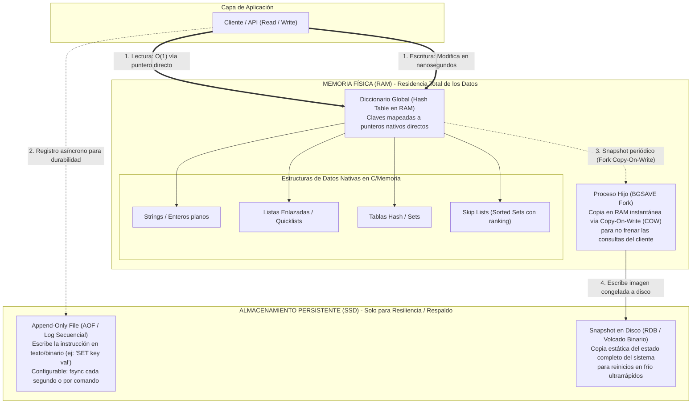

Existe un mito muy extendido sobre estas bases de datos: *"son rápidas simplemente porque no leen del disco duro"*. Kleppmann desmiente esto categóricamente. Si tienes suficiente memoria RAM en tu servidor, **un motor tradicional basado en disco (como Postgres) tampoco lee del disco**, ya que el sistema operativo mantiene todas las páginas cacheadas en RAM. 

¿Por qué son radicalmente más rápidas entonces? Porque eliminan por completo la sobrecarga de empaquetar, serializar y cuadricular la información en **bloques binarios y páginas de disco**, operando directamente sobre punteros nativos de memoria y tipos de datos en C/C++.

---

## Fundamentos de Hardware: El Coste de Traducir a "Páginas de Disco"

Para entender la arquitectura In-Memory, hay que comprender qué hace un motor tradicional cuando lee un dato que ya está en RAM:

1. **La sobrecarga de codificación (*Encoding Overhead*):** En B-Trees o LSM-Trees, la memoria guarda "páginas crudas de 4 KB/8 KB". Si pides el valor de una clave, la CPU debe tomar la página, calcular el *offset* de bytes, parsear los encabezados de la fila, deserializar los tipos de datos y lidiar con mecanismos de concurrencia y *locks* de página.
2. **Punteros nativos de CPU:** En un motor In-Memory puro, una lista enlazada o un conjunto es literalmente un conjunto de punteros de memoria de 64 bits (`0x7fff...`). La CPU sigue el puntero en un solo ciclo de instrucción sin necesidad de decodificar formatos de disco intermedios.
3. **Estructuras de datos ricas sin intermediarios:** Diseñar un *Sorted Set* (ZSET) o una cola de prioridad en disco requiere algoritmos hipercomplejos para partir y balancear bloques de 4 KiB. En RAM, simplemente creas un árbol balanceado tradicional o una *Skip List* en memoria plana.

---

## Arquitectura de la Familia In-Memory (Redis, VoltDB)

En esta arquitectura, **el estado de verdad reside 100% en la RAM**. El disco existe única y exclusivamente como un mecanismo pasivo de seguridad y durabilidad (cintas de respaldo y registros secuenciales), completamente desacoplado del camino crítico de lectura y escritura.



---

## Mecanismos de Resiliencia ante Cortes de Luz

Como la RAM es físicamente volátil, si se desenchufa el servidor todo desaparece en 1 nanosegundo. Los motores In-Memory resuelven esto con tres estrategias (a menudo combinadas):

1. **AOF (Append-Only File):**
   * Es el equivalente al WAL. Cada vez que llega un comando que muta datos (`SET`, `HSET`, `LPUSH`), se escribe secuencialmente al final de un archivo en disco.
   * *El compromiso de rendimiento:* Puedes hacer `fsync` a disco con cada comando (máxima seguridad, pero reduce la velocidad a la velocidad de un disco convencional) o hacer `fsync` cada 1 segundo en segundo plano (pérdida máxima de solo 1 segundo de datos si hay corte de luz, pero manteniendo millones de operaciones por segundo).
2. **Instantáneas periódicas (Snapshots / RDB):**
   * Cada X minutos, el motor utiliza una llamada del sistema operativo llamada `fork()`. Gracias al mecanismo de hardware **Copy-On-Write (COW)**, se crea una copia virtual instantánea de toda la base de datos sin duplicar la RAM física. Un proceso hijo recorre esa memoria y la guarda en un archivo binario consolidado.
3. **Replicación en memoria en tiempo real:**
   * La durabilidad no siempre se busca en el disco local: se envían los cambios a través de la red a una o más máquinas réplica en caliente.

# Diferencia de rendimiento de escritura y lectura

Para ver la diferencia física de rendimiento, imaginemos que queremos guardar y luego leer un objeto simple: un usuario con `id = 42` y un arreglo de compras: `[101, 204]`.

---

## 1. El Enfoque de Disco: Bloques y Páginas (Postgres, B-Trees)

Los discos solo entienden secuencias rígidas de bytes empaquetados en bloques de tamaño fijo (ej. 8 KiB). 

### Escritura (Serialización costosa)
El motor no puede simplemente "soltar" el objeto en disco. Debe calcular cómo encajarlo en una página binaria:

```text
[ Encabezado de Página (Checksum, LSN, Free Space Offset: 0x01A0) ]
[ Puntero de Item 1 (Offset: 8140) ][ Puntero de Item 2 (Offset: 8092) ]
... (espacio vacío intermedio) ...
[ Tuple Header (xmin, xmax, infomask, null_bitmap: 23 bytes) ]
[ 0x0000002A ]           <-- id: 42 (entero de 4 bytes)
[ 0x0002 ]               <-- Longitud del arreglo (2 elementos)
[ 0x00000065, 0x000000CC ] <-- Datos del arreglo binario crudo
```
* **Costo:** La CPU gasta ciclos empaquetando bytes, alineando bits al ancho de palabra y recalculando punteros de *slots* dentro de la página.

### Lectura (Deserialización)
Para leer `compras[1]`:
1. La CPU localiza la página de 8 KiB.
2. Lee el encabezado, parsea el mapa de nulos (*null bitmap*).
3. Suma el desplazamiento de bytes (*byte offset*) para saltar el encabezado y el `id`.
4. Decodifica el binario crudo a un entero que el lenguaje de programación entienda.

---

## 2. El Enfoque In-Memory: Punteros Directos en RAM (Redis)

En memoria pura no existen "páginas" ni "bloques de 8 KiB". Los datos viven como estructuras nativas del lenguaje (C/C++) enlazadas por **direcciones de memoria de 64 bits**.

### Escritura (Sin serializar)
El motor simplemente pide memoria al sistema operativo (`malloc`) y enlaza punteros:

```c
// Nodo en RAM en la dirección 0x7FFF0010
struct User {
    uint32_t id = 42;                 // 4 bytes directos en 0x7FFF0010
    uint32_t *compras = 0x7FFF00A8;   // Puntero directo (8 bytes)
};

// Arreglo en la dirección 0x7FFF00A8
[ 101, 204 ]  // Memoria contigua en RAM
```
* **Costo:** Casi cero. No se empaqueta nada en bloques; la CPU escribe las variables directamente en los transistores de la RAM.

### Lectura (Un solo ciclo de CPU)
Para leer `compras[1]`:
1. La CPU lee la dirección `0x7FFF00A8`.
2. Salta a `0x7FFF00A8 + sizeof(uint32_t)` en **1 ciclo de instrucción** (nanosegundos).
3. No hay que decodificar encabezados de página, calcular offsets dinámicos ni parsear formatos binarios.

---

## Resumen Visual del Salto

| Operación | En Disco (Bloques / Páginas) | En Memoria (Punteros Nativos) |
| :--- | :--- | :--- |
| **Cómo vive el dato** | Empaquetado en un bloque binario rígido de 4 u 8 KiB. | Instancia viva en C con punteros directos (`0x7FFF...`). |
| **Paso de Escritura** | `Objeto` $\rightarrow$ Codificar a bytes $\rightarrow$ Alinear en página $\rightarrow$ Flush. | `Objeto` $\rightarrow$ Guardar directo en la dirección de RAM. |
| **Paso de Lectura** | Parsear cabecera $\rightarrow$ Calcular offset $\rightarrow$ Deserializar binario. | **Seguir el puntero** en 1 instrucción de CPU. |

---

## Matriz Comparativa: Las Tres Familias de Motores OLTP

Ahora puedes ver el mapa completo de los tres paradigmas que rigen la industria de bases de datos:

| Dimensión | **B-Trees** (PostgreSQL, MySQL) | **LSM-Trees** (Cassandra, RocksDB) | **In-Memory** (Redis, Memcached) |
| :--- | :--- | :--- | :--- |
| **Ubicación del dato primario** | Disco (Páginas fijas de 4–16 KiB). | Disco (SSTables inmutables por niveles). | **RAM** (Estructuras de datos nativas). |
| **Rol del Disco** | Hogar principal + bitácora (WAL). | Hogar principal + log de ingesta (WAL). | **Solo respaldo y recuperación** (AOF / Snapshots). |
| **Optimizado para** | **Lecturas directas y rangos** estables. | **Escritura masiva continua** (ingesta de eventos/IoT). | **Latencias ultra-bajas (submilisegundo)** y tipos de datos complejos. |
| **Operación ante un UPDATE** | Sobreescribe bytes en una página física de disco (*In-place*). | Escribe una nueva versión al final del log; la vieja se limpia en *Compaction*. | Modifica el nodo en memoria RAM al instante. |
| **Cuello de botella principal** | I/O aleatorio en disco y divisiones de página (*Page splits*). | Presión de compactación en disco (*Compaction I/O*). | **Capacidad física y coste de la memoria RAM**. |
